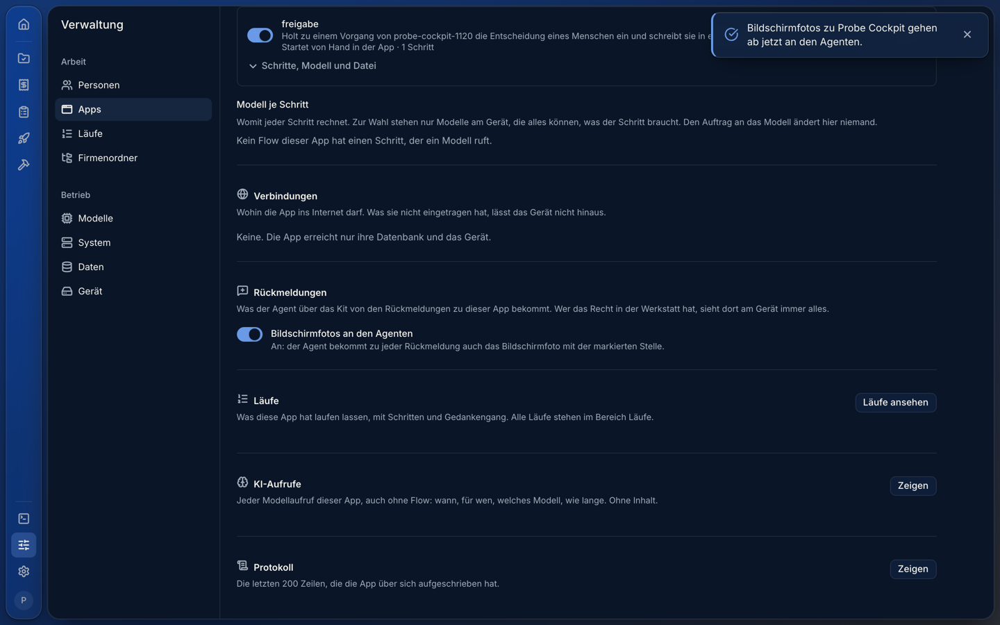
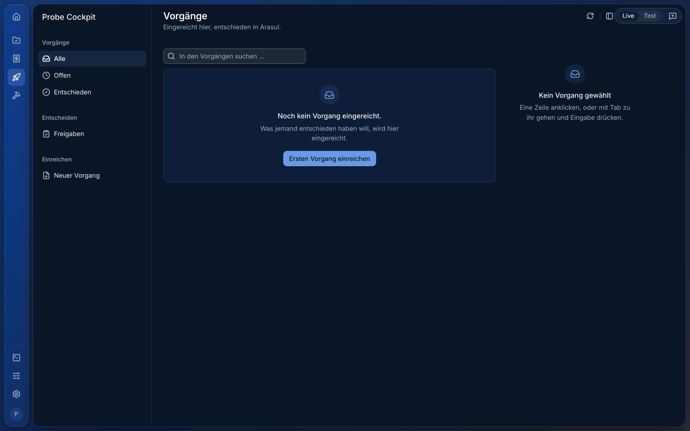
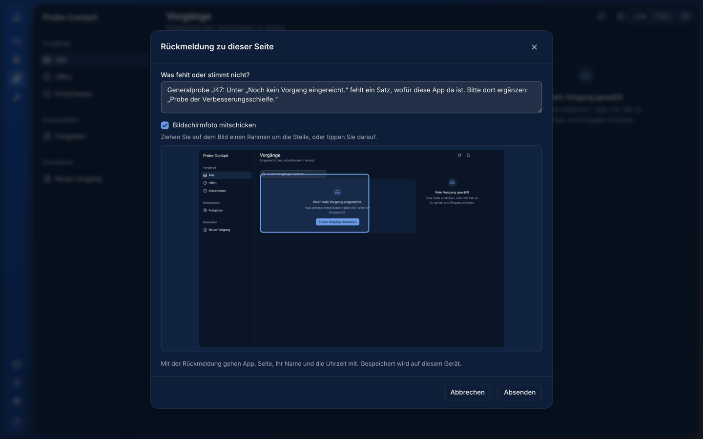
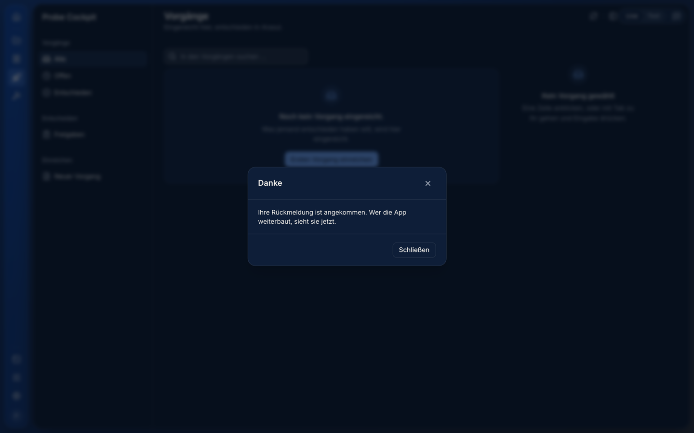
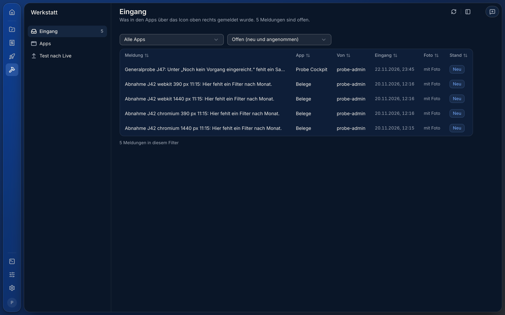
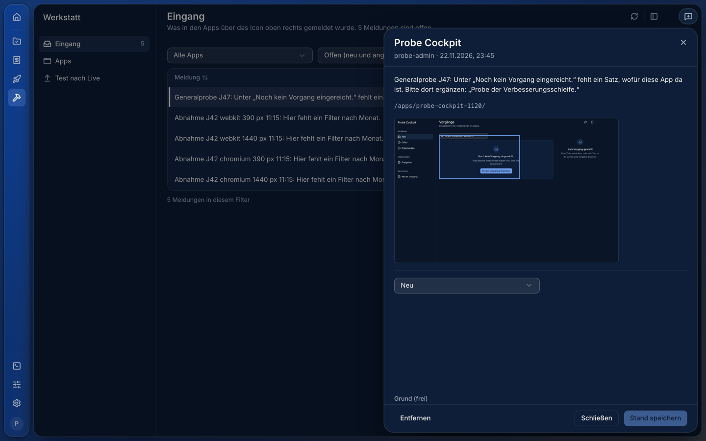
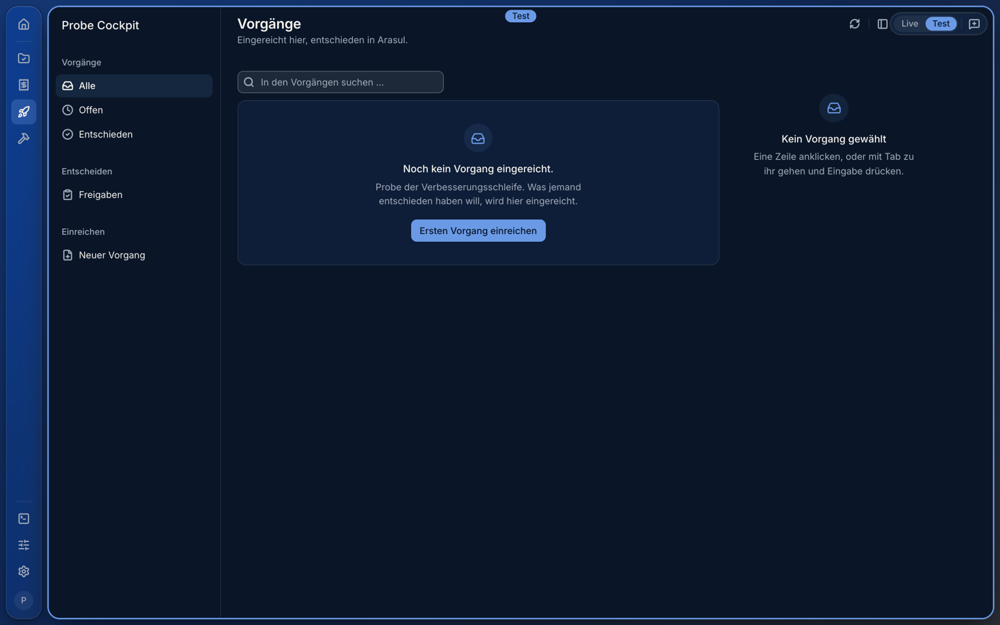
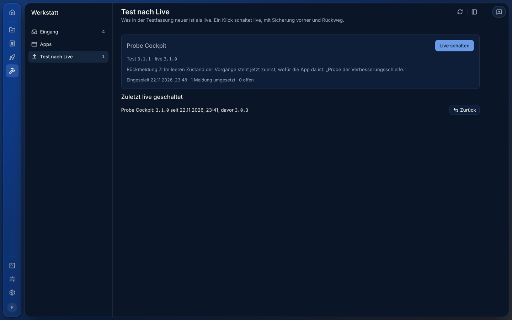
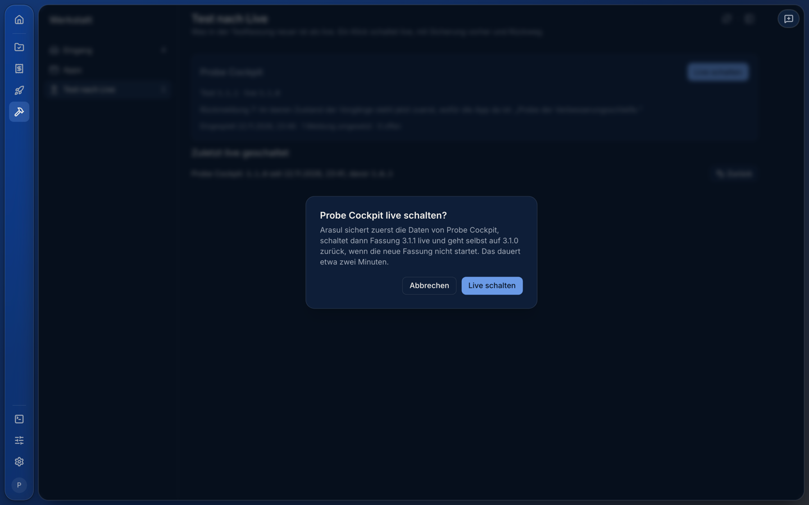
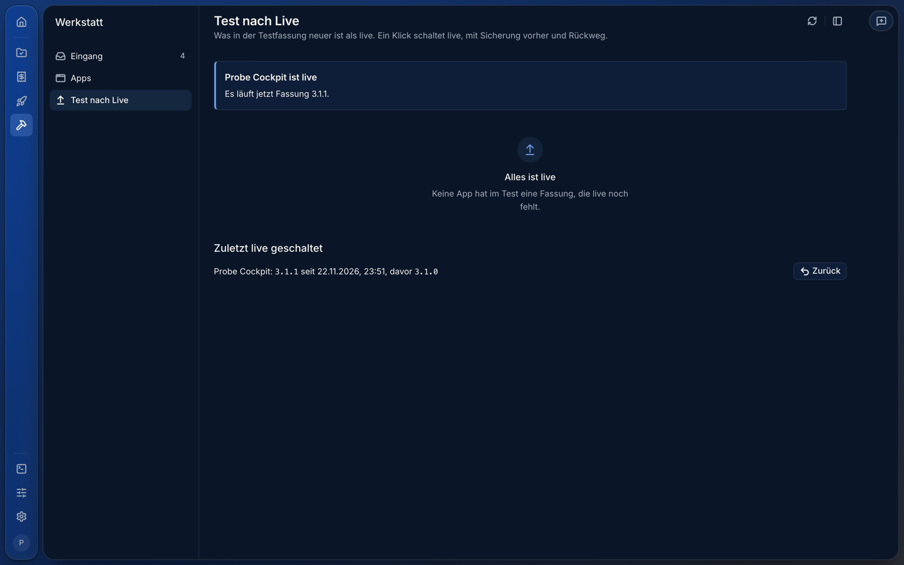

# Die Schleife am Orin abnehmen: Meldung, Werkstatt, Kit, Test, Live

> Stand 22.11.2026, Karte `schleife-generalprobe` (J47, M7). Quelle: der Vertrag
> der Verbesserungsschleife, `company/schleife.md` im Überordner, und die
> Generalprobe am Orin am 22.11.2026 mit dem Probekonto an der Probe-App
> „Probe Cockpit“. Für die zwei echten Läufe der Karte
> `schleife-abnahme-am-orin`: eine eigene App, eine echte Meldung, einmal mit
> Claude Code, einmal mit Codex, an zwei Tagen.

Dieses Blatt sagt Schritt für Schritt, was Sie klicken, was Sie im Terminal
tippen und woran Sie Grün erkennen. Was ohne Menschen prüfbar ist, prüft
`scripts/test/schleife-abnahme.mjs` vorher und nachher. Ein Lauf dauert ohne
Vorbereitung etwa 20 Minuten, davon die meiste Zeit im Gespräch mit dem Agenten.

| Schritt | Wo                         | Wer                  | Grün, wenn                                        |
| ------- | -------------------------- | -------------------- | ------------------------------------------------- |
| 0       | Terminal am Mac            | Skript               | `vorher`: „Alles grün“                            |
| 1       | Die App, Icon oben rechts  | Sie                  | „Ihre Rückmeldung ist angekommen.“                |
| 2       | Werkstatt › Eingang        | Sie                  | Die Meldung steht dort, mit Bild und Rahmen       |
| 3       | Claude Code im Kit         | Sie und der Agent    | Der Agent nennt die Meldung, Stand „angenommen“   |
| 4       | Claude Code, dann Test     | der Agent, Sie sehen | Testfassung zeigt die Änderung, Stand „umgesetzt“ |
| 5       | Werkstatt › Test nach Live | Sie                  | „… ist live. Es läuft jetzt Fassung …“            |
| 6       | Terminal am Mac            | Skript               | `nachher <nr>`: „Alles grün“                      |

## Einmal vorbereiten

Das braucht es einmal je Rechner und Gerät, nicht je Lauf.

1. **Ein Konto mit dem Recht in der Werkstatt.** Verwaltung › Personen, Spalte
   „Werkstatt“. Für Proben `probe-admin` (Passwort in Bitwarden, „Arasul Jet
   Dashboard, probe-admin (Orin)“), nie das Konto `admin`. Für die echten Läufe
   Ihr eigenes Konto mit dem Recht.
2. **Eine App mit Oberfläche, gebaut mit dem Kit.** Über einer App ohne
   Oberfläche gibt es kein Icon (die Probe-App „Probe Cockpit“ war bis zur
   Generalprobe nur ein Backend und bekam dafür die Vorlage des Kits als
   Fassung 3.1.0). Der Quelltext muss als `apps/<app>/` im Klon des Kits
   liegen, sonst kann der Agent lesen und ablehnen, aber nichts umsetzen.
3. **Ein Klon des Kits mit Geräteakte und zwei Schlüsseln.** Kein Passwort in
   eine Datei, auch nicht in `.env`: die Ablage ist der Schlüsselbund.

   ```bash
   git clone https://github.com/Arasul-GmbH/ara-kit.git && cd ara-kit
   # business/profile.md aus .ara/templates/profile.de.md, darin:
   #   role: company
   #   secrets_store: keychain
   node .ara/tools/device.mjs --host 100.121.244.80 --user arasul --name orin
   node .ara/tools/device.mjs --name orin --deploy-key      # zum Ausrollen
   node .ara/tools/feedback.mjs --device orin --key         # nur für Meldungen
   ```

   Grün: „Kit-Schlüssel: hinterlegt unter ARASUL_KEY_ORIN“ und „Geprüft: das
   Gerät beantwortet diesen Schlüssel.“ Die Schlüssel liegen im Schlüsselbund
   unter dem Dienst `ara-kit`.

4. **Bilder an den Agenten, wenn er das Foto sehen soll.** Verwaltung › Apps ›
   (App) › Rückmeldungen › „Bildschirmfotos an den Agenten“. Vorgabe ist aus;
   dann bekommt der Agent nur Text, Seite und App.

   

## Schritt 0: vorher prüfen

```bash
ARASUL_PLAYWRIGHT=/Users/koljaschope/Code/arasul/arasul-jet \
ARASUL_BENUTZER=probe-admin \
ARASUL_PASSWORT="$(geheim get 'Arasul Jet Dashboard, probe-admin (Orin)')" \
ARASUL_SCHLUESSEL="$(security find-generic-password -a ARASUL_FEEDBACK_ORIN -s ara-kit -w)" \
ARASUL_APP=<app> \
node scripts/test/schleife-abnahme.mjs vorher
```

Grün: „Alles grün (12).“ Es prüft Anmeldung, das Recht, die Werkstatt, Test-
und Livefassung mit Oberfläche, dass **im Test nichts wartet** (sonst wäre
„Test nach Live“ in Schritt 5 nicht nur Ihre Änderung), das Icon über der App,
dass ein Klick ein Foto aufnimmt, und mit dem Schlüssel den Kontrakt und die
Sicht des Kits. Die letzte Zeile sagt, ob Bilder an den Agenten gehen.

## Schritt 1: melden, über das Icon

Öffnen Sie die App in der Leiste links. Oben rechts, neben Live und Test, steht
das Icon (Sprechblase mit Plus).



Ein Klick nimmt das Bildschirmfoto auf und öffnet das Formular. Schreiben Sie,
was fehlt, und ziehen Sie auf dem Foto einen Rahmen um die Stelle.



„Absenden“. **Grün:** „Ihre Rückmeldung ist angekommen. Sie steht mit ihrem
Stand in der Werkstatt.“



## Schritt 2: die Meldung in der Werkstatt

Werkstatt (Hammer in der Leiste) › Eingang. **Grün:** die Meldung steht oben,
mit App, Ihrem Namen, „mit Foto“ und Stand „Neu“.



Ein Klick öffnet sie: Text, Seite, das Foto mit Ihrem Rahmen. Den Stand setzen
Sie hier nicht, das tut in Schritt 3 der Agent. Die Nummer der Meldung steht
im Kit, nicht hier.



## Schritt 3: der Kit-Befehl holt sie

Im Klon des Kits eine Sitzung öffnen, `claude` (beim zweiten Lauf `codex`),
und tippen:

```text
/feedback <app>
```

Der Agent sagt in zwei Sätzen, dass er nur die Testfassung ändert und nie live
schaltet, und holt die offenen Meldungen. Darunter läuft:

```bash
node .ara/tools/feedback.mjs --device orin --app <app>
node .ara/tools/feedback.mjs --device orin --app <app> --image <nr>   # nur mit Erlaubnis
```

So sah es in der Generalprobe aus:

```text
# Rückmeldungen zu Probe Cockpit (probe-cockpit-1120) von orin

Bildschirmfotos: für diese App erlaubt. Eines holen mit --image <nr>; es bleibt auf diesem Rechner im Ordner der App.

1 offene Meldung, in 1 Anliegen. Vorgeschlagene Reihenfolge:

1. [Wunsch] Nr. 7 · neu · live
   - 7: „Generalprobe J47: Unter „Noch kein Vorgang eingereicht.“ fehlt ein Satz, …“
     /apps/probe-cockpit-1120/ · probe-admin · 2026-11-22 22:45 · mit Bildschirmfoto
```

Der Agent fragt je Anliegen: umsetzen (mit einem Satz, was sich ändert),
ablehnen (mit Grund) oder später. Ihre Antwort ist die Freigabe. **Grün:** er
setzt die Meldung auf „angenommen“ (`--set <nr> --to angenommen`, „neu →
angenommen“). Die Uhrzeit im Kit ist UTC, in der Werkstatt Ortszeit.

## Schritt 4: der Agent ändert die Testfassung

Er schreibt einen Plan mit der Nummer der Meldung, baut mit Tests und rollt in
den Test, über den festen Ablauf des Kits:

```bash
node .ara/tools/app.mjs --app <app> --plan "<titel>"
node .ara/tools/app.mjs --app <app> --plan-aktiv <datei>
node .ara/tools/app.mjs --app <app> --build          # Tests, Nachweis
node .ara/tools/app.mjs --device orin --app <app> --deploy --aenderungstext "<was neu ist>"
node .ara/tools/feedback.mjs --device orin --app <app> --set <nr> --to umgesetzt
```

**Grün:** „Ergebnis: eingespielt, <app> <fassung> im Stand "test"“, danach
„angenommen → umgesetzt“. Die Fassung muss höher sein als die live laufende;
das Kit weist sonst ab. Sehen Sie sich die Testfassung an: in der App oben
rechts „Test“.



## Schritt 5: Test nach Live, in der Werkstatt

Werkstatt › Test nach Live. Dort steht die App mit beiden Fassungen und dem
Änderungstext des Agenten, darunter „1 Meldung umgesetzt“.



„Live schalten“, Rückfrage lesen, „Live schalten“.



**Grün** nach etwa einer halben Minute: „<App> ist live. Es läuft jetzt
Fassung …“. Darunter „Zurück“, 24 Stunden lang, auf die Fassung davor.



## Schritt 6: nachher prüfen

```bash
ARASUL_PLAYWRIGHT=/Users/koljaschope/Code/arasul/arasul-jet \
ARASUL_BENUTZER=probe-admin \
ARASUL_PASSWORT="$(geheim get 'Arasul Jet Dashboard, probe-admin (Orin)')" \
ARASUL_SCHLUESSEL="$(security find-generic-password -a ARASUL_FEEDBACK_ORIN -s ara-kit -w)" \
ARASUL_APP=<app> ARASUL_ERWARTET="<ein Text, der jetzt live steht>" \
ARASUL_ERGEBNIS=schleife-ergebnis.jsonl \
node scripts/test/schleife-abnahme.mjs nachher <nr>
```

Grün: „Alles grün (14).“ Geprüft wird: die Meldung gehört zur App, mit Foto
und Stelle, Stand „umgesetzt“; nach der Meldung kam eine neue Fassung in den
Test, danach eine Schaltung nach live; Test und Live sind gleich; „umgesetzt“
kam erst nach dem Einspielen; die Live-Seite kommt mit Icon und zeigt den
erwarteten Text; das Kit sieht die Meldung als „umgesetzt“.


`ARASUL_ERGEBNIS` hängt je Aufruf eine Zeile JSON an (`art`, `schritt`, `app`,
`meldung`, `zeit`, `gruen`, `rot`, `pruefungen`). Diese Zeile ist für das
Cockpit des Überordners gedacht; wo sie dort gelesen wird, entscheidet der
Überordner.

## Was das Skript nicht prüft

- Ob Text und Bild zum Umsetzen gereicht haben, und ob der Agent die richtige
  Frage gestellt hat. Das beurteilen Sie im Gespräch.
- Ob die Änderung die gemeinte ist. `ARASUL_ERWARTET` prüft nur, dass ein Text
  live steht.
- Ob Codex denselben Ablauf trägt: das ist der zweite echte Lauf.

`melden "<text>"` geht Schritt 1 ohne Sie (für Proben und Bilder); in einer
echten Abnahme melden Sie selbst.

## Aufräumen nach einer Probe

- Eigene Probe-Meldungen entfernen: Werkstatt › Eingang › Meldung ›
  „Entfernen“. Nur die eigenen, nie fremde.
- Schlüssel eines Wegwerf-Klons widerrufen:
  `node .ara/tools/feedback.mjs --device orin --revoke-key` und
  `node .ara/tools/device.mjs --name orin --revoke-key`.
- Container, Volumes und Datenbanken bleiben, wie sie sind.

## Was die Generalprobe gefunden hat

Am 22.11.2026 lief die Schleife einmal ganz durch: Meldung 7 an Probe Cockpit,
Fassung 3.1.1 in den Test, live geschaltet, `nachher 7` 14 von 14 grün. Bericht:
[`docs/plans/audits/2026-11-22-schleife-generalprobe/`](../plans/audits/2026-11-22-schleife-generalprobe/README.md).

| Fund                                                                                                         | Was geschah                                            |
| ------------------------------------------------------------------------------------------------------------ | ------------------------------------------------------ |
| Die Probe-App hatte keine Oberfläche, also kein Icon                                                         | Vorlage des Kits als Probe Cockpit 3.1.0               |
| Im Blatt einer Meldung war die Auswahl des Stands 224 px hoch, „Grund“ lag unter dem Fuß                     | Behoben, Werkstatt `Eingang.tsx`                       |
| Die Bestätigung sagte nicht, wo die eigene Meldung wieder zu lesen ist                                       | Behoben: „Sie steht mit ihrem Stand in der Werkstatt.“ |
| Im Kit: „Der Mitarbeiter … erfährt davon nichts“ nach jedem `--set`, und dasselbe im Wissen `feedback.de.md` | Fund fürs Kit, stimmt seit J52 nicht mehr              |
| Im Kit: Uhrzeit der Meldung in UTC ohne Hinweis, Markierung mit 16 Nachkommastellen                          | Fund fürs Kit                                          |
| Im Kit: der Flow der Vorlage nennt die Kennung statt des Namens der App                                      | Fund fürs Kit                                          |
